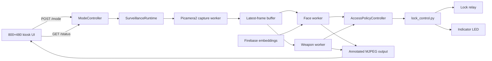
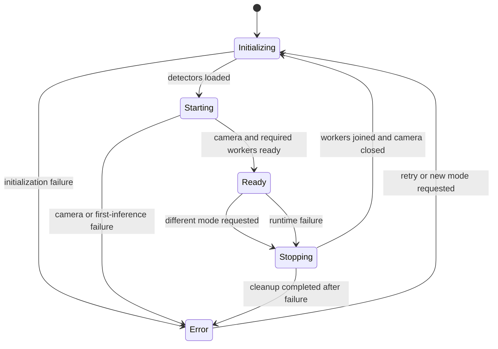

# Surveillance_system_IERD
This is a surveillance system project for IERD, BCSIR. The programs are written in python 3.11.2 for raspberry pi 5.

If you want to replicate the work, ensure you have **libcamera** and **venv** package installed in the system. First, create a virtual environment with access to system packages:

    python3.11 -m venv venv --system-site-packages

Then activate the venv:

    source venv/bin/activate

Finally install the dependencies:

    pip install -r requirements.txt

Update the codes to include your Firebase credentials and database url.

That's it. You should be good to run the scripts. Details are provided in the code should you require.

## What this project does

This repository contains a Raspberry Pi–based surveillance prototype that combines:

- Real‑time weapon/object detection using a TensorFlow Lite YOLOv5 model
- Real‑time face recognition powered by the `face_recognition` (dlib) library
- Cloud‑backed identity storage with Firebase Realtime Database

The system is designed for on‑device inference on a Raspberry Pi 5 (ARM64), using the official Raspberry Pi Camera via the modern libcamera/PiCamera2 stack.

## Hardware and OS requirements

- Raspberry Pi 5 running 64-bit Raspberry Pi OS with libcamera/Picamera2
- Raspberry Pi Camera Module or compatible Picamera2 device
- Waveshare 7-inch 800×480 HDMI touchscreen
- GPIO-controlled lock relay or driver circuit
- Lock-state indicator LED
- Network connectivity for Firebase face embeddings

GPIO uses BCM numbering. The defaults are BCM 23 for the active-low lock output
and BCM 24 for the indicator LED. The LED is illuminated while the commanded
lock state is closed. A relay or suitable driver must isolate the Raspberry Pi
from the lock's power circuit.

## System design

The application uses one camera owner, a serialized mode controller, independent
inference workers, and one access-policy controller. Detection workers never
write directly to GPIO. They publish observations to the access policy, which is
the only component allowed to request a lock-state change.



### Runtime components

| Component | Responsibility |
|---|---|
| `web_ui.py` | Flask routes, MJPEG response, status API, mode-selection API, and recording API |
| `ModeController` | Serializes mode changes and prevents concurrent camera owners |
| `SurveillanceRuntime` | Owns Picamera2, frame publication, inference workers, annotations, and metrics |
| `raw_recording.py` | Handles Raw Feed recording, temporary takes, save, and retake |
| `FaceDetector` | Matches faces against Firebase embeddings and produces named detections |
| `WeaponDetector` | Runs YOLOv5 TFLite inference and produces class/confidence detections |
| `AccessPolicyController` | Fuses face and weapon observations into lock decisions |
| `lock_control.py` | Drives the configured lock and LED pins and records commanded state |
| `system_config.yaml` | Defines camera, detector, timing, model, and GPIO policy values |

The camera worker assigns a monotonically increasing sequence number to each
frame. Inference workers wait for a newer sequence and therefore do not process
the same frame repeatedly. Full System mode runs face and weapon inference
independently so a slow model does not block camera capture or the other worker.

### Operating modes

| Mode | Camera | Face inference | Weapon inference | Lock behavior |
|---|---:|---:|---:|---|
| Raw Feed | Yes | No | No | Preserves the current command |
| Face Recognition | Yes | Yes | No | Diagnostic only; cannot unlock |
| Weapon Detection | Yes | No | Yes | Can lock on pistol or knife; cannot unlock |
| Full System | Yes | Yes | Yes | Can grant timed face access; weapons override immediately |

The configured mode is not marked ready until its camera is producing frames and
every required inference worker has completed at least one successful pass.

## Touchscreen UI and recording

The UI fits an 800×480 display, keeps inference metrics in a bottom strip,
and shows the full camera frame without cropping.

In **Raw Feed** mode, the Live Detections box provides recording controls:

1. **START RECORDING** begins a video without audio.
2. **STOP RECORDING** ends the take without saving it permanently.
3. **SAVE** keeps a timestamped H.264 MP4 in `/home/ierd/recorded_data/`.
   **RETAKE** discards the take and starts a new recording.

The directory is created automatically. Leaving Raw Feed or shutting down
normally discards unsaved takes. Recording controls appear only in Raw Feed;
other modes keep their existing behavior.

Recording requires FFmpeg and FFprobe (`sudo apt install ffmpeg`). A dedicated
recording worker keeps FFmpeg running after browser requests finish. Recording
errors appear in the box and server terminal.

After backend code changes, restart `python web_ui.py` and refresh the browser.

## Mode-controller finite-state machine



Only one transition may execute at a time. During a transition, the access
policy is placed in a non-unlocking transition mode. The old workers are
signalled, joined, and the camera is closed before the next runtime opens it. If
a worker cannot stop safely, the next mode is not started.

## Access-control finite-state machine

The access policy starts fail-secure with a commanded closed lock. All enrolled
Firebase identities are currently treated as authorized identities.

```mermaid
stateDiagram-v2
    [*] --> Locked: fail-secure startup
    Locked --> FacePending: recognized face in Full System
    FacePending --> Unlocked: required confirmations and fresh safe weapon scan
    FacePending --> Locked: confirmation expires
    Unlocked --> Locked: access window expires
    Locked --> WeaponHold: any configured weapon detected
    FacePending --> WeaponHold: any configured weapon detected
    Unlocked --> WeaponHold: any configured weapon detected
    WeaponHold --> Locked: hold expires; fresh face required
    Locked --> Fault: camera, inference, or GPIO failure
    FacePending --> Fault: camera, inference, or GPIO failure
    Unlocked --> Fault: camera, inference, or GPIO failure
    WeaponHold --> Fault: camera, inference, or GPIO failure
    Fault --> Locked: healthy runtime successfully replaces faulted runtime
```



### Access rules and timing

- A face must be recognized twice within the configured three-second
  confirmation window.
- Full System must also have a non-stale weapon scan before access is granted.
- A successful authorization opens the lock for five seconds.
- The same continuously visible face cannot repeatedly reopen the lock. Face
  authorization rearms after the face has been absent for two seconds.
- Any configured weapon-class observation closes the lock immediately from any access
  state and refreshes a ten-second weapon hold.
- When the weapon hold expires, the system remains closed and requires a new
  face authorization.
- Camera, worker, model, or GPIO failures command the lock closed.
- Mode changes do not create a second camera owner or allow a starting face-only
  pipeline to inherit Full System's unlock permission.

## State reporting

`/status` exposes the active/requested mode, transition state, capture FPS,
inference timings, current detections, access-policy state, reason, countdown,
GPIO availability, configured pins, and commanded lock state.

The UI represents access state as:

| Policy state | UI meaning |
|---|---|
| `locked` | `CLOSED` |
| `face_pending` | `CLOSED · VERIFYING` |
| `unlocked` | `OPEN` |
| `weapon_hold` | `CLOSED · ALERT` |
| `fault` | `CLOSED · FAULT` |

The displayed value is the state commanded by software. Confirming that the
physical mechanism actually moved requires a separate lock-position sensor.

## GSM Mode (SIM808)

Select **GSM Mode**, then **ENABLE MODE**. This standalone test stops the camera
pipeline and does not grant door access. It opens the configured UART and requires
an exact `AT` / `OK` exchange before showing **ACTIVE**. A SIM is not required for
this check. The UART is checked periodically; connection failure enters the normal
mode failure/retry workflow.

`config/system_config.yaml` contains the `gsm` settings: default phone number,
BCM TX/RX pins, serial device, baud rate, command/SMS timeouts and health interval.
The confirmed Raspberry Pi 5 setup uses `/dev/ttyAMA0`, 9600 baud, TX GPIO14
(physical pin 8) and RX GPIO15 (physical pin 10). Connect Pi TX to module RX,
Pi RX to module TX, and common ground. GPIO settings document the supported
14/15 pair; changing YAML does not configure OS UART routing. Existing Pi boot
configuration must enable this UART (`dtparam=uart0=on`).

Install the added dependency in the environment used by the web service:

```bash
cd /home/ierd/Surveillance_2.0/Surveillance_system_IERD
venv/bin/python -m pip install 'pyserial>=3.5,<4.0'
```

Restart the running web application and refresh Chromium. If using systemd,
check `systemctl cat surveillance-web` first: the supplied deployment template
uses an older repository location, so ensure your actual service launches this
checkout. The service user needs read/write permission on the UART (usually
membership in `dialout`; a new login or service restart is needed after adding it).

### Final hardware diagnosis

1. With the module powered and no SIM installed, enable GSM Mode. Expect
   **ACTIVE**, **AT OK**, `/dev/ttyAMA0` and **9600 baud** in the main area.
2. Try **SEND MESSAGE**. Expect a SIM readiness error, while the module remains
   active. The default phone number should be `+8801719473555`.
3. Tap the phone and message fields and test your OS on-screen keyboard in
   Chromium kiosk. These are standard HTML inputs; keyboard availability and
   automatic appearance depend on desktop configuration. No embedded keyboard
   is installed by this change. The right panel scrolls to keep controls reachable.
4. With power off, install a working SIM, then power on. After network registration,
   send a short English test SMS. A successful submission confirms network
   acceptance, not delivery to the recipient. Text is limited to 160 printable
   ASCII characters on one line; non-English text and control characters are rejected.
5. Press **CALL**, confirm the destination rings, then **HANG UP**. The UI reports
   dialing acceptance; voice audio requires the module's microphone/speaker wiring.
6. Switch to another mode during a call: the call should end and UART close.
   Return to GSM Mode and confirm it starts again. Removing module power while
   active should produce **MODE FAILED** after the health check timeout.

Run simulated tests without a SIM or UART:

```bash
venv/bin/python -m unittest discover -s tests -v
```


## Automatic weapon alerts in Full System

Full System now opens a shared GSM connection in a background worker. Every
configured detector class (including pistol, rifle and knife) triggers the lock
weapon hold and can queue an SMS to `gsm.default_phone`. Other camera modes do
not send automatic alerts. Standalone GSM Mode retains its manual controls.

Configure `gsm.alerts` in `config/system_config.yaml`:

- `enabled`: enable automatic alerts in Full System.
- `sms_enabled`: send the configured `message` (1–160 printable English ASCII characters).
- `call_enabled`: optionally dial the same number after the SMS attempt; defaults
  to **false**. Calling is attempted even if the SMS fails.
- `call_duration`: seconds before automatically hanging up an accepted call.
- `cooldown`: minimum seconds between alert attempts (default 60).
- `clear_duration`: consecutive seconds of successful weapon-free scans before
  another detection episode can trigger an alert (default 5). Stale scan gaps
  do not count as clear time.

A continuous detection sends one alert attempt, rather than one per frame. A new
weapon episode detected during cooldown can trigger once cooldown expires if it
is still being detected. Failed attempts consume the cooldown too and require
rearming; they do not retry continuously. Mode changes reset episode/cooldown
tracking. SMS submission confirms network acceptance, not recipient delivery.

The Full System detection panel shows GSM readiness and the latest alert result.
Missing SIM, network errors, or disconnected UART do not stop camera processing
or lock protection. GSM initialization/reconnection failures require leaving and
re-enabling Full System after correcting the problem. Serial commands run in a
separate worker; shutdown cancels queued alerts, ends any call, and waits for an
in-progress bounded modem operation before releasing the UART.

### Hardware verification for automatic alerts

1. Restart the application, refresh the UI, and enable Full System. With no SIM,
   expect GSM readiness from AT OK; present a configured weapon class and expect
   a visible SMS error while video/detection continue.
2. With a working SIM/network, present each configured class in separate episodes.
   Confirm the configured SMS reaches the default phone and the lock remains held.
3. Keep a detection visible beyond 60 seconds: it should not repeatedly alert.
   Clear the scene for at least five seconds, wait until the cooldown has elapsed,
   then present a weapon again to trigger another alert.
4. To test optional calling, set `call_enabled: true`, restart, and trigger a new
   episode. Expect an SMS attempt followed by dialing and automatic hangup after
   `call_duration`. Restore `false` and restart when finished.
5. Switch away from Full System during an alert/call and verify resource cleanup;
   GSM Mode should subsequently open the same UART normally.
